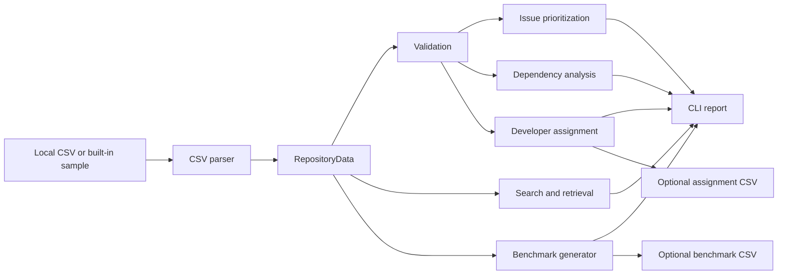

# Architecture and Data Flow



## Modules

| Module | Responsibility |
| --- | --- |
| `include/issueflow/domain.hpp`, `src/domain.cpp` | Typed records, CSV parsing, validation, dependency graph creation, sample/stress data. |
| `include/issueflow/algorithms.hpp`, `src/algorithms.cpp` | Manual algorithms, metrics, comparison helpers, and reusable algorithm interfaces. |
| `src/main.cpp` | Input validation, menu orchestration, reporting, and local CSV export. |
| `tests/test_issueflow.cpp` | Unit and integration checks for domain workflow and the algorithm laboratory. |
| `data/` | Normal, capacity-shock, and invalid-cycle datasets. |

## Assignment design

The same compatibility predicate is used by the two alternatives:

```text
developer is compatible with issue
iff developer.capacity >= issue.effort
    and every required issue skill is in developer.skills
```

The **maximum bipartite matching** mode constructs an implicit edge for each compatible developer-issue pair. Its DFS augmentation routine finds a maximum-cardinality one-to-one matching. That makes its objective explicit and easy to trace live.

The **greedy capacity allocation** mode is a comparator: it visits issues in priority order and chooses the compatible developer with the smallest remaining sufficient capacity. It permits multiple issues per developer, but it is not presented as an optimal global assignment. The contrast demonstrates solution coverage versus realistic capacity usage.

## Dependency design

For an issue dependency `I2 -> I1` (I2 depends on I1), the stored graph edge is `I1 -> I2`. Kahn-style topological processing emits only zero-indegree work; when several issues are ready, the higher-priority issue is chosen first. If no ready issue exists before all issues are emitted, the remaining nodes form a dependency cycle and validation rejects the dataset.
