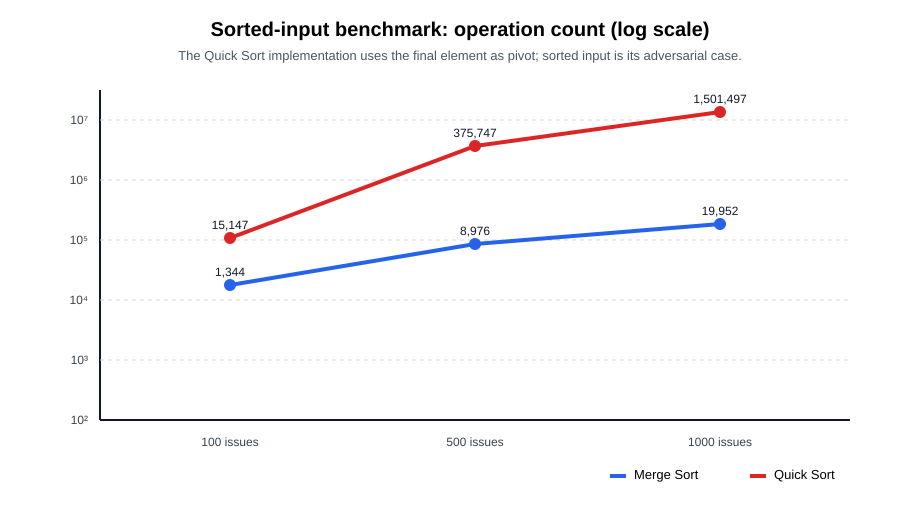

# Benchmark Evidence

## Run conditions

| Field | Recorded value |
| --- | --- |
| Date | 2026-11-18 |
| Build command | `g++ -std=c++17 -Werror -Wall -Wextra -Wpedantic -Iinclude src/domain.cpp src/algorithms.cpp src/main.cpp -o build/iflow.exe` |
| Compiler | MinGW.org GCC 6.3.0 |
| Language standard | C++17 |
| Operating system | Windows NT 10.0.26200.0, 64-bit |
| Processor information available to the run | Intel64 Family 6 Model 197 Stepping 2 |
| Benchmark mode | One interactive run of CLI option 11 |

The execution environment did not allow reading the CPU marketing name or installed RAM. Add those two fields from the target machine before final submission.

## Raw results

The full machine-readable output is [benchmark_results_2026-11-18.csv](benchmark_results_2026-11-18.csv). A zero millisecond value means the local clock resolution was not sufficient for that small case; use operation counts and repeated median timing in the final viva report.

| Input | Merge operations | Quick operations | Quick operations on sorted input | Matching coverage | Greedy coverage |
| ---: | ---: | ---: | ---: | ---: | ---: |
| 100 | 1,344 | 1,287 | 15,147 | 26 | 53 |
| 500 | 8,976 | 8,022 | 375,747 | 126 | 264 |
| 1000 | 19,952 | 20,736 | 1,501,497 | 251 | 524 |

## Findings

1. On the generated mixed-priority data, Merge Sort and Quick Sort return the same deterministic priority order.
2. On already sorted input, the final-pivot Quick Sort remains correct but its operation count grows quadratically; Merge Sort remains close to `n log n`.
3. Maximum bipartite matching optimizes one-to-one coverage. The greedy allocator permits multiple issues per developer, so it covers more issues in this dataset but does not prove global optimality.

## Repetition protocol

Run option 11 three times after closing heavy applications. Export each run to a dated CSV, calculate a median for nonzero timing values, and retain all raw CSV files. Do not average a zero-millisecond timer reading as if it were a precise measurement.
